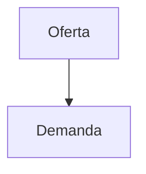

# IPPSE — Documentos e Informes

Repositorio público de contenido del **Instituto de Profesionales Paraguayos del Sector Eléctrico (IPPSE)**.

Aquí vive el contenido editable del sitio: los informes técnicos y las publicaciones.
El sitio web se genera automáticamente a partir de estos archivos, así que **publicar un
informe nuevo no requiere tocar el código del sitio**: se agrega un archivo `.md` y listo.

---

## Estructura

```
ippse-documentos/
├── README.md                      ← este archivo
├── contenido/
│   └── publicaciones/             ← un archivo .md por informe o publicación
│       ├── informe-2-26.md
│       └── ...
├── documentos/                    ← PDFs oficiales de los informes
│   └── informe-2-26.pdf
├── imagenes/                      ← imágenes de los informes
│   └── informe-2-26/              ← una carpeta por publicación (mismo id que el .md)
│       └── portada.png
└── esquema/
    └── publicacion.schema.json    ← campos válidos del frontmatter
```

## Cómo publicar un informe nuevo

1. Creá un archivo en `contenido/publicaciones/`. El **nombre del archivo es el `id`** de la
   publicación: usá minúsculas, sin tildes y con guiones (`balance-oferta-demanda-2026.md`).
2. Escribí la cabecera YAML (frontmatter) con los datos del informe y, debajo, el contenido
   en Markdown.
3. Si el informe lleva imágenes, ponélas en `imagenes/<id>/` y referencialas con rutas
   relativas (`../../imagenes/<id>/portada.png`).
4. Si el informe tiene un PDF oficial, ponelo en `documentos/` y declaralo en el frontmatter
   con `pdf: informe-2-26.pdf` (ver más abajo).
5. Subí los cambios. El sitio se regenera solo.

Los nombres de archivo que empiezan con `_` o `.` se ignoran (sirven para borradores).

> **Sobre la actualización:** al publicar, el sitio tarda unos minutos en regenerarse. Cuando lo
> hace, fija el *commit* exacto de este repositorio y lee los archivos de ahí, así que siempre
> muestra la versión correcta: no hay que esperar a que se refresque ninguna caché.

## Formato del archivo

```markdown
---
titulo: Balance oferta-demanda del Sistema Interconectado Nacional 2026–2030
fecha: 2026-10-01
categoria: diagnostico
autor: Comité Técnico Asesor
extracto: Actualización del balance entre oferta y demanda de potencia y energía del SIN.
lectura: 32
estado: publicado
---

## Resumen ejecutivo

El presente informe analiza...

## Metodología

...
```

### Campos del frontmatter

| Campo       | Obligatorio | Tipo   | Descripción |
|-------------|-------------|--------|-------------|
| `titulo`    | Sí          | texto  | Título completo del informe. |
| `fecha`     | Sí          | fecha  | `AAAA-MM-DD` o `AAAA-MM`. Ordena el listado. |
| `categoria` | Sí          | opción | `diagnostico`, `propuesta` u `opinion`. |
| `autor`     | Sí          | texto  | Autor o comité responsable. |
| `extracto`  | Sí          | texto  | Resumen de 1–2 frases para la tarjeta. |
| `lectura`   | No          | número | Minutos de lectura estimados. |
| `estado`    | No          | opción | `publicado` (por defecto) o `proximamente`. |
| `pdf`       | No          | texto  | Ruta al PDF oficial, si existe. |
| `portada`   | No          | texto  | Imagen de portada, relativa a `imagenes/<id>/`. |
| `etiquetas` | No          | lista  | Palabras clave para búsqueda y SEO. |
| `destacado` | No          | bool   | `true` para resaltarlo en la portada del sitio. |

El esquema completo y validable está en [`esquema/publicacion.schema.json`](esquema/publicacion.schema.json).

## Imágenes

Cada publicación puede tener su propia carpeta en `imagenes/`:

```
imagenes/
└── informe-2-26/
    ├── portada.png
    └── figura-1-demanda.png
```

Se referencian desde el Markdown con rutas relativas. Ojo con la profundidad: el `.md` vive
en `contenido/publicaciones/`, así que para llegar a la raíz del repositorio hacen falta
**dos** niveles (`../../`):

```markdown

```

Formatos recomendados: **PNG** para gráficos y **JPG/WebP** para fotografías. Evitá archivos
de más de 1–2 MB; conviene comprimirlos antes de subirlos.

## PDFs oficiales

Los PDFs de los informes viven en la carpeta `documentos/` de este repositorio.

```markdown
---
titulo: Informe Técnico Nº 2/26
pdf: informe-2-26.pdf
---
```

El campo `pdf` del frontmatter admite dos formas:

| Valor | Dónde vive el archivo |
|-------|-----------------------|
| `informe-2-26.pdf` | En `documentos/` de este repositorio. Es lo habitual. |
| `documentos/informe-2-26.pdf` | Igual que el anterior (la carpeta es opcional). |
| `/documentos/archivo.pdf` | En el propio sitio web (solo para archivos ya alojados allí). |

Con esto, el botón **PDF** de la tarjeta y el de **Descargar PDF** del visor apuntan solos al
archivo: **no hay que tocar el código del sitio**.

Para enlazar un PDF dentro del texto del informe, usá la ruta relativa a la raíz:

```markdown
[Descargar el informe completo](../../documentos/informe-2-26.pdf)
```

## Enlaces

Los enlaces se resuelven solos según su destino:

| En el Markdown | Resultado |
|----------------|-----------|
| `[texto](https://ejemplo.com)` | Se abre en una pestaña nueva. |
| `[otro informe](./informe-2-26.md)` | Abre ese informe en el visor del sitio. |
| `[un PDF](../../documentos/x.pdf)` | Descarga el archivo del repositorio. |
| `#seccion` | Salta a esa sección del mismo documento. |

## Convenciones

- **Idioma:** español (Paraguay). UTF-8.
- **Fechas:** siempre ISO (`AAAA-MM-DD`). Sin comillas en el YAML.
- **Un solo `#` (H1)** por documento, o ninguno: el sitio usa el `titulo` del frontmatter.
- **Secciones:** usá `##` para las secciones principales; el sitio genera el índice a partir de ellas.
- **Mojibake:** guardá los archivos en UTF-8 sin BOM para que las tildes y `–` se vean bien.

### Markdown extendido

Además del Markdown habitual (títulos, listas, tablas, negrita, enlaces, imágenes), el visor
del sitio entiende:

**Notas al pie**

```markdown
El factor de planta[^1] incide en la energía firme.

[^1]: Relación entre la energía generada y la que se generaría a potencia nominal.
```

**Diagramas (Mermaid)**

````markdown

````

**Fórmulas (LaTeX)**

```markdown
En línea: $E = mc^2$

En bloque:

$$
\eta = \frac{P_{salida}}{P_{entrada}}
$$
```

## Licencia y uso

El contenido es propiedad del IPPSE y se publica para consulta y difusión. Citá la fuente
como *IPPSE — Instituto de Profesionales Paraguayos del Sector Eléctrico*.
