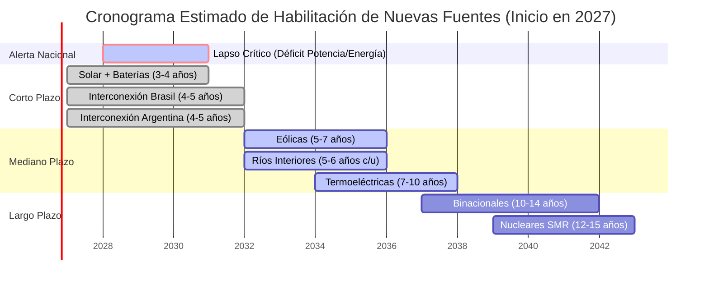
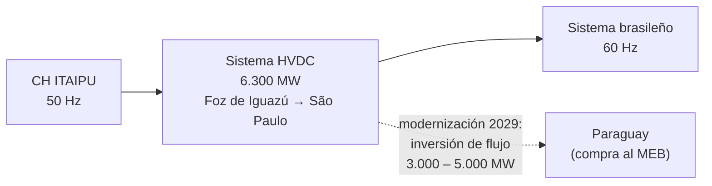
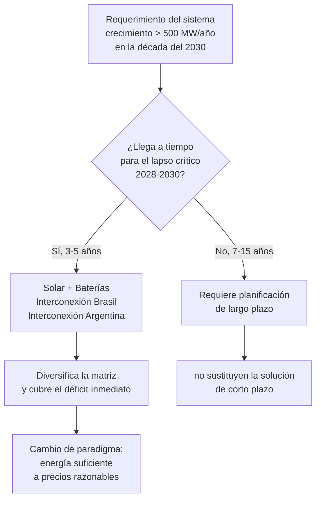

**REQUERIMIENTOS DE GENERACIÓN ELÉCTRICA PARA CUBRIR LA DEMANDA DE POTENCIA Y EL CONSUMO DE ENERGÍA DEL PARAGUAY**

**RIESGO DE CRISIS ENERGÉTICA**  
**Periodo 2026 – 2035**

**PARTE II: ALTERNATIVAS DE NUEVAS FUENTES**  
*Aprobado en Reunión del Comité Ejecutivo del IPPSE de fecha 14.10.2026*

---

## 1. OBJETO

Recientemente, en fecha 29.06.2026, el IPPSE ha emitido un Informe titulado “Requerimientos de Generación Eléctrica para cubrir la Demanda de Potencia y el Consumo de Energía del Paraguay – Riesgo de Crisis Energética – Periodo 2026-2035”, abarcando el corto y mediano plazo (5 y 10 años), que será elaborado en 3 partes:

*   **Parte I** – Fuentes actuales
*   **Parte II** – Alternativas de nuevas fuentes
*   **Parte III** – Planes de expansión

Así, fue emitido en esa fecha la “Parte I – Fuentes actuales”, y en esta oportunidad se presenta a conocimiento y consideración de la ciudadanía la “Parte II – Alternativas de nuevas fuentes”, donde se analizan las posibles nuevas fuentes de generación para atender los requerimientos futuros del sistema eléctrico, con sus objetivos, características, factibilidades, situación, costos y cronogramas estimados, así como las acciones que deben cumplirse para realizar esos proyectos.

Particularmente, y conforme a las conclusiones del citado anterior Informe del IPPSE, se hace hincapié en los siguientes **DESAFÍOS**:

a) Soluciones para el “lapso crítico 2028-2030”, cuando deberían incorporarse nuevas fuentes de generación para superar el “riesgo de crisis energética por déficit de Potencia y Energía” en los años siguientes (2031 en adelante);
b) Sustentar los “grandes requerimientos futuros de generación eléctrica”;
c) Diversificar la “matriz electro-energética”, para no seguir dependiendo exclusivamente de la hidroelectricidad, tal como hasta ahora.

---

## 2. CONCLUSIONES – RESUMEN EJECUTIVO

Como conclusiones principales del presente Informe, se resaltan las siguientes fuentes posibles y sus plazos de habilitación:

| Rol en la planificación | Fuente | Plazo de habilitación |
|---|---|---|
| **Desafíos a, b y c** — corto, mediano y largo plazo (5, 10 y más años) | Centrales Solares con Bancos de Baterías | 3 a 4 años |
| | Interconexión eléctrica con Brasil | 4 a 5 años |
| | Interconexión eléctrica con Argentina | 4 a 5 años |
| **Desafíos b y c** — mediano y largo plazo (más de 5 y 10 años) | Centrales Hidroeléctricas Binacionales | 10 a 14 años |
| | Centrales Termoeléctricas | 7 a 10 años |
| | Centrales Nucleares (SMR) | 12 a 15 años |
| **Complementarias** — Desafío c, mediano y largo plazo | Centrales Hidroeléctricas Ríos Interiores | 5 a 6 años c/u; totalidad 15 a 20 años |
| | Centrales Eólicas | 5 a 7 años |
| **Energía firme** — mediano y largo plazo | Centrales Termoeléctricas | 7 a 10 años |
| | Centrales Nucleares (SMR) | 12 a 15 años |

### 2.1. Ventana crítica 2028-2030

El siguiente esquema ubica cada alternativa en el tiempo, en relación con el “lapso crítico 2028-2030” que el sistema eléctrico nacional debe superar:

---

## 3. ALTERNATIVAS DE NUEVAS FUENTES DE GENERACIÓN

### 3.1. CENTRALES HIDROELÉCTRICAS BINACIONALES

Se analizan los emprendimientos hidroeléctricos binacionales posibles en el río Paraná, con Argentina y con Brasil, que tienen como objetivo principal atender los requerimientos de Potencia y Energía de los países involucrados, optimizando el potencial energético y económico del río; los mercados eléctricos de los mismos absorberían toda la producción.

Cabe destacar que todos esos proyectos aún están en fases preliminares, por lo cual no están formalmente programados para ser construidos y contar con su disponibilidad para atender los requerimientos; aún no están encaminados para su realización, que fundamentalmente dependen de decisiones políticas y negociaciones entre las partes involucradas.

Así, se estiman cronogramas para estos proyectos que parten del supuesto de que en el año 2027 se realizarían gestiones y conversaciones previas e inicio de negociaciones formales entre las partes, ya sean todos los proyectos o solamente algunos seleccionados.

**Bibliografía:** la mayoría de los datos mencionados en este capítulo son meramente referenciales y orientativos (datos técnicos, costos, cronogramas, etc.). Fueron recopiladas y utilizadas para el análisis diversas informaciones públicas de las instituciones relacionadas ([COMIP](https://comip.org.ar/), [YACYRETÁ](https://eby.gov.py/), [ITAIPU](https://www.itaipu.gov.py/), entrevistas a referentes, prensa y otros), algunas muy antiguas y otras recientes, que requieren ser actualizadas y oficializadas por las instituciones pertinentes para una mejor evaluación.

#### 3.1.1. AMPLIACIÓN CENTRAL HIDROELÉCTRICA YACYRETÁ

**Objetivos:**
*   Aumentar la capacidad de la Central con más 10 unidades generadoras, completando las 30 unidades previstas en el Tratado de YACYRETÁ.
*   Valorizar su operación como “Central de Punta”, además de su operación como “Central de Base” tal como principalmente en la actualidad.

**Características:**
*   La ampliación aportará fundamentalmente Potencia al sistema, que [ANDE](https://www.ande.gov.py/) requiere para modular técnica y económicamente su diagrama de carga y satisfacer sus necesidades.
*   El aporte de más Energía no será significativo, ya que se utilizará la misma afluencia de agua, aunque la mayor disponibilidad de máquinas permitirá un mejor aprovechamiento, así como en casos de mayores afluencias del río Paraná.
*   Para la instalación de 10 unidades adicionales y operación como “Central de Punta”, se necesitará un Embalse Compensador aguas abajo de la CH YACYRETÁ.
*   En el Tratado de YACYRETÁ está previsto el Embalse Compensador ITÁ YBATÉ, pero una mejor opción sería la construcción de la CH ITACORÁ-ITATÍ, cuyo embalse actuaría además como Compensador de la CH YACYRETÁ.

**Datos técnicos:**

| Parámetro | Actual | Ampliación | Total |
|---|---|---|---|
| Potencia | 3.100 MW (20 máq. × 155 MW) | 1.550 MW (10 máq. × 155 MW) | 4.650 MW (30 máq.) |
| Energía | 20.000 GWh/año | 1.200 GWh/año | 21.200 GWh/año |
| Factor de Planta | 74 % (nominal) | — | 52 % |

**Situación y acciones requeridas:**
Su realización está relacionada con:
*   Actualización/realización de estudios avanzados de factibilidad técnica, económica, financiera y ambiental para el emprendimiento.
*   Solución a la cuestión de la deuda de YACYRETÁ.

**Construcción, Costo y Cronograma:**
Sería realizada en 2 etapas, con financiamiento de la [EBY](https://eby.gov.py/) (supuesto):

| Etapa | Alcance | Costo directo | Costo unitario |
|---|---|---|---|
| Primera | 3 unidades de 155 MW (operan sin Embalse Compensador) | US\$ 1.120 millones | 2.400 US\$/kW |
| Segunda | 7 unidades de 155 MW (requiere Embalse Compensador previo: ITACORÁ-ITATÍ o ITAYBATÉ) | US\$ 2.600 millones | 2.400 US\$/kW |

**Cronograma estimado:** plazo total 14 años
*   **2027 – 2031 (5 años):** Negociaciones con Argentina, estudios varios (factibilidad, impacto social y ambiental, etc.), licencias, ingeniería, forma de construcción y financiamiento, elaboración PBC, licitaciones, adjudicaciones y contratos.
*   **Obras Civiles y Electromecánicas:**
    *   Primera Etapa: 2032 – 2036 (5 años)
    *   Segunda Etapa: 2037 – 2040 (4 años)
*   **Operación:**
    *   Primera Etapa: 2035 – 2036 (3 unidades, 10 años)
    *   Segunda Etapa (*): 2038 – 2040 (7 unidades, 14 años)
    *   *(\*) Fecha estimada de habilitación del Embalse Compensador ITACORÁ-ITATÍ*

> **Nota:** si en el 2027 se decide realizar este proyecto, entraría en operación recién a finales de la década del 2030. En esa época, su capacidad de 775 MW (aprox.) para el Paraguay, cubriría solamente el crecimiento de 1 año de la Demanda nacional, según las proyecciones.

#### 3.1.2. CENTRAL HIDROELÉCTRICA ITACORÁ – ITATÍ

**Objetivos:**
*   Además de la generación de energía, posibilitará actuar como Embalse Compensador de la CH YACYRETÁ (en sustitución de ITÁ YBATÉ), lo que permitirá aumentar su capacidad con la instalación de más 10 unidades generadoras, potenciando su operación como “Central de Punta”, además de mejorar las condiciones hidrodinámicas de operación de sus turbinas;
*   Mejorar la navegabilidad del río Paraná aguas abajo de CH YACYRETÁ, posibilitando la navegación de buques de mayor calado y contribuyendo a un tráfico fluvial más importante en la región;
*   Recuperación de áreas frecuentemente inundadas ante crecidas del río Paraná.

**Datos técnicos:**

| Parámetro | Valor |
|---|---|
| Potencia | 1.660 MW (32 unid. de 52 MW c/u) |
| Energía | 11.300 GWh/año |
| Factor de Planta | 78 % |
| Operación | Central de “base” |
| Esclusa de navegación | prevista en el proyecto |

**Situación y acciones requeridas:**
Su realización está relacionada con:
*   Actualización/realización de estudios avanzados de factibilidad técnica, económica, financiera y ambiental para el emprendimiento.
*   Definición de la forma para construir y financiar la obra: estatal, privado (concesión), asociación público-privada, etc.

**Costo estimado:** US\$ 5.000 millones costo directo; 3.000 US\$/kW instalado; LCOE 38 USD/MWh sin regalías (*Levelized Cost of Energy* – Costo nivelado de la Energía). El financiamiento dependerá del método para realizar el emprendimiento.

**Cronograma estimado:** plazo total 14 años
*   **2027 – 2032 (6 años):** Negociaciones con Argentina, estudios varios (factibilidad, impacto social y ambiental, etc.), licencias, ingeniería, forma de construcción y financiamiento, elaboración PBC, licitaciones, adjudicaciones y contratos.
*   **2033-2040 (8 años):** Construcción Obras Civiles y Electromecánicas.
*   **2038 – 2040 (14 años):** Operación (todas las unidades).

**Emplazamiento:**
*   Ubicación estratégica, a 44 km de la confluencia de los ríos Paraná y Paraguay, en el Departamento de Ñeembucú (PY) y Provincia de Corrientes (AR).
*   Cercano a 3 centros urbanos de gran importancia: Pilar (PY), Resistencia y Corrientes (AR).
*   Posibilitará la integración física del Departamento de Ñeembucú con la Provincia de Corrientes, con el derivado de los beneficios adicionales que eso implica.
*   Representará un potencial energético importante para suministro a emprendimientos industriales en la región del Ñeembucú.

> **Nota:** si en el 2027 se decide realizar este proyecto, entraría en operación recién a finales de la década del 2030. En esa época, su capacidad de 830 MW (aprox.) para el Paraguay, cubriría solamente el crecimiento de 1 año de la Demanda nacional, según las proyecciones.

#### 3.1.3. CENTRAL HIDROELÉCTRICA CORPUS CHRISTI

**Emplazamiento:**
*   Se han estudiado 3 alternativas: ITACUÁ, ITACURUBÍ y PINDOÍ.
*   La alternativa de PINDOÍ (cercano a Pto. Hohenau - PY), considerada la más factible por menor territorio inundado y menores efectos ambientales, ha sido más desarrollada.

**Datos técnicos PINDOÍ:**

| Parámetro | Valor |
|---|---|
| Potencia | 2.880 MW (20 unid. de 144 MW c/u) |
| Energía | 20.175 GWh/año |
| Factor de Planta | 80 % |
| Operación | Central de “Base” |
| Esclusa de navegación | prevista en el proyecto |

**Situación y acciones requeridas:**
Su realización está relacionada con:
*   Actualización/realización de estudios avanzados de factibilidad técnica, económica, financiera y ambiental para el emprendimiento.
*   Definición de la forma para construir y financiar la obra: estatal, privado (concesión), asociación público-privada, etc.
*   Levantamiento de las restricciones del Plebiscito realizado el 14.04.1996 en la Provincia de Misiones, Argentina, por el cual la población se manifestó en contra del Proyecto CORPUS, entre otros argumentos, por gran cantidad de territorio inundado, efectos ambientales y necesaria participación de la Provincia en la toma de decisiones; en consecuencia, todo quedó suspendido (en juego: cuestiones políticas, sociales, ambientales, económicas y energéticas).
*   Revisión del “Acuerdo Tripartito entre Paraguay, Brasil y Argentina referente al aprovechamiento hidroeléctrico del Río Paraná”, suscrito el 19.10.1979, por el cual se establecieron condiciones para la construcción y operación de la futura CH CORPUS y para la operación de la CH ITAIPU, a fin de optimizar la producción de ésta, y al mismo tiempo, la navegación del río Paraná aguas abajo.
*   Actualización de estudios y negociaciones sobre los efectos del embalse de la CH CORPUS sobre el salto y la operación de CH ITAIPU y CH ACARAY.

**Costo estimado:** US\$ 7.500 millones costo directo; 2.600 US\$/kW instalado; LCOE 33 USD/MWh sin regalías (*Levelized Cost of Energy* – Costo nivelado de la Energía). El financiamiento dependerá del método para realizar el emprendimiento.

**Cronograma estimado:** plazo total 13 años
*   **2027 – 2032 (6 años):** Negociaciones con Argentina y con Brasil, levantamiento Plebiscito de Misiones, estudios varios (factibilidad, impacto social y ambiental, etc.), licencias, ingeniería, forma de construcción y financiamiento, elaboración PBC, licitaciones, adjudicaciones y contratos.
*   **2033-2039 (7 años):** Construcción Obras Civiles y Electromecánicas.
*   **2037 – 2039 (13 años):** Operación (todas las unidades).

> **Nota:** si en el 2027 se decide realizar este proyecto, entraría en operación recién a finales de la década del 2030. En esa época, su capacidad de 1.440 MW (aprox.) para el Paraguay, cubriría solamente el crecimiento de 2 años de la Demanda nacional, según las proyecciones.

#### 3.1.4. AMPLIACIÓN CENTRAL HIDROELÉCTRICA ITAIPU

**Objetivos:**
*   Disponibilidad de Potencia ampliada para las horas de máxima demanda de los sistemas eléctricos del Paraguay y del Brasil;
*   Aprovechar los caudales excedentes que serían eventualmente vertidos, aumentando la generación de Energía ante mayor afluencia de agua en los meses lluviosos;
*   Importantes beneficios para el Paraguay y el Brasil en materia energética y económica (regalías).

**Situación y acciones requeridas:**
*   Estudios preliminares realizados indican prefactibilidad técnica y energética del proyecto, con interesantes valores estimados de aguas de vertimientos, de costo, de capacidad de producción, posible ubicación y cronograma de implantación. Se requieren estudios avanzados al respecto.
*   Para posibilitar el aumento de capacidad de generación en CH ITAIPU habrá que negociar con Brasil y con Argentina, según corresponda, para modificar el Anexo “B” del Tratado de ITAIPU y el “Acuerdo Tripartito entre Paraguay, Brasil y Argentina referente al aprovechamiento hidroeléctrico del Río Paraná” suscrito el 19.10.1979, que estableció condiciones para la construcción y operación de la futura CH CORPUS y para la operación de la CH ITAIPU.

**Datos técnicos:**

| Parámetro | Valor |
|---|---|
| Potencia | 1.400 MW (a decidir: 2×700 MW o 4×350 MW, y la Frecuencia) |
| Energía estimada | 3.000 GWh/año |
| Factor de Planta | 25 % |
| Operación | Central de “Punta” |
| Ubicación | entre el Vertedero y la Subestación Margen Derecha, por motivos de construcción |

**Costo estimado:** US\$ 1.600 millones costo directo; 1.150 US\$/kW instalado. El financiamiento será definido por las Altas Partes.

**Cronograma estimado:** plazo total 10 años
*   **2027 – 2031 (5 años):** Negociaciones con Brasil y con Argentina, estudios varios (factibilidad, impacto social y ambiental, etc.), licencias, ingeniería, forma de construcción y financiamiento, elaboración PBC, licitaciones, adjudicaciones y contratos.
*   **2032-2036 (5 años):** Construcción Obras Civiles y Electromecánicas.
*   **2035 – 2036 (10 años):** Operación (todas las unidades).

> **Nota:** si en el 2027 se decide realizar este proyecto, entraría en operación recién a finales de la década del 2030. En esa época, su capacidad de 700 MW (aprox.) para el Paraguay, cubriría solamente el crecimiento de 1 año de la Demanda nacional, según las proyecciones.

#### 3.1.5. AUMENTO DE CAPACIDAD UNIDADES GENERADORAS EN CH ITAIPU

La posibilidad de repotenciación de las máquinas actuales está siendo estudiada por los órganos internos de la Entidad Binacional con el apoyo de consultorías especializadas; se esperan resultados en el plazo estimado de 1 (un) año. Luego, con mayores detalles, se podrá analizar debidamente.

Así, y hasta tanto, no puede ser considerada como alternativa real para disponer de más Potencia en la CH ITAIPU a fin de atender a los requerimientos futuros del Paraguay.

**Bibliografía:** informaciones públicas, prensa, entrevistas a referentes y otros.

#### 3.1.6. Comparación de los emprendimientos binacionales

| Emprendimiento | Potencia | Energía | Inversión (costo directo) | Costo unitario | LCOE | Plazo | Para el Paraguay |
|---|---|---|---|---|---|---|---|
| Ampliación YACYRETÁ | 1.550 MW (+10 máq.) | 1.200 GWh/año | US\$ 1.120 + 2.600 M | 2.400 US\$/kW | — | 14 años | 775 MW |
| ITACORÁ – ITATÍ | 1.660 MW | 11.300 GWh/año | US\$ 5.000 M | 3.000 US\$/kW | 38 USD/MWh | 14 años | 830 MW |
| CORPUS CHRISTI (PINDOÍ) | 2.880 MW | 20.175 GWh/año | US\$ 7.500 M | 2.600 US\$/kW | 33 USD/MWh | 13 años | 1.440 MW |
| Ampliación ITAIPU | 1.400 MW | 3.000 GWh/año | US\$ 1.600 M | 1.150 US\$/kW | — | 10 años | 700 MW |

Los plazos de habilitación se ubican entre 10 y 14 años: quedan por fuera del “lapso crítico 2028-2030”.

### 3.2. CENTRALES HIDROELÉCTRICAS RÍOS INTERIORES DEL PARAGUAY

Estas instalaciones tienen el objetivo principal de aprovechar los recursos hídricos nacionales, recursos renovables, para la generación de energía eléctrica.
Además, representarán beneficios técnicos para la red, económicos, sociales y políticos en las zonas de emplazamiento (desarrollo de las comunidades, comercio, agua potable, pesca, turismo y otros).

**Características:**
Se dispone públicamente de un inventario hidroenergético realizado para el aprovechamiento de las cuencas hidrográficas localizadas en la región oriental del Paraguay, para las vertientes de los ríos interiores de las cuencas de los ríos Paraguay y Paraná.
En esa investigación, fueron seleccionadas 16 cuencas hidrográficas con potencial para la producción de energía, con el objetivo principal de identificar sitios con potencial aprovechable de 5 MW o más, orientados a pequeñas y medianas centrales hidroeléctricas (PCH y MCH).

Los resultados resumidos son los siguientes:

*   **Potencial Hidroeléctrico Hipotético (PHH)** con Potencia variada: 1.745 emplazamientos; Potencia total 1.048 MW; Energía total 524 MWmedios (4.590 GWh/año)
*   **Potencial Hidroeléctrico Aprovechable (PHA)** con Potencia igual o superior a 1 MW: 70 emplazamientos; Potencia Total 531 MW; Energía total 266 MWmedios (2.330 GWh/año)
*   **Potencial Hidroeléctrico Aprovechable (PHA)** con Potencia igual o superior a 5 MW: 22 emplazamientos; Potencia total 398 MW; Energía total 199 MWmedios (1.743 GWh/año)

La Energía se expresa indistintamente como potencia media (MWmedios) o como energía anual (GWh/año). La conversión entre ambas se obtiene multiplicando la potencia media por las horas del año:

$$E\,[\mathrm{GWh}] = P_{\mathrm{media}}\,[\mathrm{MW}] \times 8{.}760\ \mathrm{h}$$

En el cuadro siguiente se muestran los 22 emplazamientos con Potencia igual o superior a 5 MW, que en principio podrían ser estimados como posibles de ser realizados.

**RÍOS INTERIORES DEL PARAGUAY - PEQUEÑAS Y MEDIANAS CENTRALES HIDROELÉCTRICAS (Igual o superior a 5 MW)**
*Potencial Hidroeléctrico Aprovechable (PHA) - Factor de planta utilizado: 50%*

| ID | Cuenca | Cant. de emplazamientos | Potencia MW | Energía MWmedios | Energía GWh/año |
|---|---|---|---|---|---|
| 1 | Aquidabán | 0 | 0,0 | 0,0 | 0,0 |
| 2 | Ypané | 5 | 39,7 | 19,9 | 174,1 |
| 3 | Jejuí | 3 | 24,7 | 12,4 | 108,4 |
| 4 | Manduvirá/Tapiracuai | 0 | 0,0 | 0,0 | 0,0 |
| 5 | Tebicuarymí | 0 | 0,0 | 0,0 | 0,0 |
| 6 | Carapá | 2 | 39,9 | 20,0 | 174,9 |
| 7 | Pozuelo | 0 | 0,0 | 0,0 | 0,0 |
| 8 | Itambey | 1 | 6,6 | 3,3 | 29,0 |
| 9 | Limoy | 0 | 0,0 | 0,0 | 0,0 |
| 10 | Acaray | 1 | 8,6 | 4,3 | 37,6 |
| 11 | Monday | 2 | 170,2 | 85,1 | 745,3 |
| 12 | Ñacunday | 3 | 61,7 | 30,8 | 270,2 |
| 13 | Tembey | 3 | 26,2 | 13,1 | 114,9 |
| 14 | Pirayuí | 1 | 13,4 | 6,7 | 58,9 |
| 15 | Pirapó | 0 | 0,0 | 0,0 | 0,0 |
| 16 | Capiibary | 1 | 6,7 | 3,3 | 29,3 |
| **TOTAL** | | **22** | **397,8** | **198,9** | **1.742,5** |

Cabe señalar, que la poca capacidad individual y total de estos 22 aprovechamientos superiores a 5 MW, aprox. 400 MW si todos fueren construidos a lo largo de varios años, sería insuficiente para atender los grandes requerimientos futuros del sistema, crecientes a más de 500 MW/año en la década del 2030. Por esa razón, su aporte sería más bien complementario.

Desde luego, no pueden descartarse a priori los aprovechamientos con potencial inferior a 5 MW si los mismos fueren técnica y económicamente factibles, desarrollados a largo plazo.

**Situación:** la mayoría de estos aprovechamientos estimados posibles tienen datos e informaciones muy preliminares, salvo pocas excepciones, por lo que necesitan más desarrollo para ser realizados.

**Costo estimado:** entre 2.500 y 3.000 USD/kW instalado; LCOE entre 50 y 70 USD/MWh

**Cronograma estimado y acciones requeridas:** 5 a 6 años cada uno (en promedio) y la totalidad podría llevar entre 15 y 20 años, por la necesidad de mayor desarrollo de esas posibilidades preliminares, por la complejidad que conllevan y por los esfuerzos que se requerirán para realizarlos, tales como (*) gestiones y estudios varios (localización, topografía, terrenos afectados, histórico de mediciones de caudales; factibilidad técnica y económica; impacto social y ambiental; obtención de licencias; forma de construcción y financiamiento; etc.)
*(\*) Procesos según correspondan, encarados por [ANDE](https://www.ande.gov.py/), instituciones responsables y/o inversionistas interesados.*

**Otras Centrales:** además de las posibilidades antes mencionadas, también se dispone de los siguientes proyectos preliminares que necesitan más desarrollo y cuya realización llevaría más de 10 años, largo plazo. Por lo tanto, aún no pueden ser considerados como alternativas reales para disponer de más Potencia y Energía a fin de atender a los requerimientos futuros.
*   Maquinización de la Presa Yguazú, Potencia 70 MW y Energía 359 GWh/año; previsto en el Plan Maestro de Generación de la ANDE (nivel: estudios básicos).
*   Construcción de la Tercera Casa de Máquinas en la Central Acaray, Potencia 75 MW y Energía 307 GWh/año; previsto en el Plan Maestro de Generación de la ANDE (nivel: estudios básicos).
*   Central Hidroeléctrica en el Río Paraguay, en el km 480, Potencia 72 MW y Energía 359,5 GWh/año; se contemplan esclusas para la navegación (nivel: estudios básicos del año 1980).
*   Central Hidroeléctrica en el Río Paraguay, en el km 610, Potencia 96 MW y Energía 479,3 GWh/año; se contemplan esclusas para la navegación (nivel: estudios básicos del año 1980).

**Bibliografía:**
*   ATLAS DEL POTENCIAL HIDROENERGÉTICO DEL PARAGUAY - INVENTARIO HIDROENERGÉTICO, elaborado por [ITAIPU Binacional](https://www.itaipu.gov.py/), Fundación Parque Tecnológico ITAIPU (FPTI_PY) - Año 2011
*   PLAN MAESTRO DE GENERACIÓN DE LA ANDE, Periodo 2024 - 2043

### 3.3. CENTRALES SOLARES

Estas instalaciones generan energía eléctrica a partir de la energía solar obtenida al captar la luz y el calor del sol (radiación solar) mediante paneles o colectores para transformarlos en electricidad. Es una fuente de energía inagotable, y una de las más eficientes y económicas del sector de las renovables.
La utilización de la luz (energía solar fotovoltaica) y la utilización del calor (energía termosolar) son los más conocidos para generar electricidad a partir de la radiación solar.

En la energía solar fotovoltaica, de mayor uso y aquí analizada, la luz solar captada se transforma en electricidad mediante paneles fotovoltaicos (placas solares con celdas de silicio).
Para una alta producción, estos equipos se agrupan en parques solares ubicados estratégicamente en zonas con buena radiación solar disponible y que requieren grandes extensiones de terreno para su instalación (aprox. 1,5 hectáreas/MW).

**Características:**
Este tipo de fuente de generación es intermitente, porque depende del ciclo del día y del clima. No funciona de noche porque no hay luz suficiente para activar las células fotovoltaicas y generar electricidad; asimismo, su capacidad se reduce significativamente con nubes y lluvias, aunque siguen funcionando. Por lo tanto, no es una fuente de energía firme.

Al ser fuentes intermitentes de energía (Factor de Capacidad entre 20 y 30%) pueden asociarse con Bancos de Baterías (BESS – *Battery Energy Storage Systems*) para almacenamiento y uso combinado, inyectando Potencia al sistema cuando se requiera.
Hay varios tipos de baterías, pero las de “iones de litio (Li-ion)” son las que tienen mejor capacidad de almacenamiento y tienen mayor duración (8 a 10 años), aunque son las más caras.

La energía anual generable se relaciona con la potencia instalada y el factor de capacidad:

$$E\,[\mathrm{GWh}] = P_{\mathrm{inst}}\,[\mathrm{MW}] \times 8{.}760\ \mathrm{h} \times FC$$

Donde $P_{\mathrm{inst}}$ es la potencia instalada, $FC$ el factor de capacidad (típicamente $0{,}20$ a $0{,}30$ para solar) y $8.760$ las horas del año.

**Situación nacional:**
Para conocer mejor las características energéticas del sol en una determinada región se requieren conocimiento de la cantidad y distribución de la radiación solar que incide en un lugar determinado, y de su variación temporal a lo largo de los ciclos diario, mensual y anual.

Conforme a mediciones registradas, se dispone de informaciones suficientes sobre el potencial energético solar en todo el territorio nacional; los resultados disponibles muestran potencial en las diversas regiones del país, mayormente en las regiones norte y noroeste (Chaco), noreste y central. Hay condiciones muy favorables, con una densidad excepcional de 1.725 kWh/m²-año, más de 310 días soleados al año en promedio y condiciones climáticas estables durante la mayor parte del año.

Esas informaciones indican que Paraguay posee un potencial solar alto, por lo cual son factibles grandes parques solares con capacidad igual o superior a 100 MWp.
Este gran potencial de energía solar es de absoluta relevancia para cubrir los grandes requerimientos futuros de Energía y Potencia del sistema eléctrico nacional, mediante la combinación de Parques Solares Fotovoltaicos con Bancos de Baterías de Alta Potencia asociados.

**Costo estimado:**

| Configuración | Costo de inversión | LCOE |
|---|---|---|
| Parque Solar de 100 MWp | 800 a 1.200 USD/kW instalado | 40 a 55 USD/MWh |
| Parque Solar de 100 MWp + Banco de Baterías de 100 MW/400 MWh (4 hs de duración) | 1.300 a 1.900 USD/kW instalado | 60 a 80 USD/MWh |

Estos costos dependen de la ubicación geográfica de la instalación, de la capacidad, de la configuración, de la tecnología y de la procedencia de los equipos.

> **Nota:** si los parques solares se ubican en lugares remotos, lejos de las redes, pueden requerir la construcción de muchos kilómetros de Líneas de Transmisión para transportar la energía generada, así como, pueden requerir infraestructura vial y conectividad. Eso puede encarecer las iniciativas, por lo que es clave analizar la ubicación y el entorno del proyecto para asegurar su viabilidad. Consecuentemente, el costo estimado de instalación arriba mencionado no incluye Subestación ni Línea de Transmisión para conexión a la red eléctrica.

**Cronograma estimado:** 3 a 4 años (parque solar de 100 MWp). Puede variar según los procesos para su realización y la disponibilidad de los equipos (cadena de suministros).

**Acciones requeridas:**
*   Los datos e informaciones disponibles son potenciales y suficientes, con los cuales se pueden profundizar estudios para desarrollar y realizar proyectos de porte significativo que contribuyan a los requerimientos futuros de Potencia y Energía del sistema eléctrico nacional.
*   Luego serán necesarios varios procesos (*) para realizarlos, tales como gestiones y estudios varios (localización, topografía, terrenos afectados, mediciones de radiación solar; factibilidad técnica y económica; impacto social y ambiental; obtención de licencias; forma de construcción y financiamiento; etc.)
*   *(\*) Procesos según correspondan, encarados por [ANDE](https://www.ande.gov.py/), instituciones responsables y/o inversores interesados.*

**❖ PARQUES SOLARES FLOTANTES:**
El gran espejo de agua del embalse de la Presa de ITAIPU puede ser aprovechado para instalar Parques Solares Flotantes de gran capacidad con almacenamiento mediante Baterías, lo que representará beneficios para Paraguay y Brasil, así como para la propia ITAIPU.
La [ITAIPU Binacional](https://www.itaipu.gov.py/) ha iniciado esta experiencia con un plan piloto, mediante la instalación de una Planta Solar Flotante de 1,1 MW con resultados exitosos de costos reducidos y otros efectos, que está alimentando al consumo propio de la CH ITAIPU. Actualmente está en estudios la instalación de Baterías para esta PSF.
En cuanto a la posibilidad de instalar Plantas Solares Flotantes de gran capacidad con almacenamiento mediante Baterías, si bien es técnicamente posible, recién está en conversaciones incipientes entre las partes, por lo que aún no se dispone de resultados. Luego, con mayores detalles, se podrá analizar debidamente.

Además, deberán analizarse las exigencias (técnicas y costos) en la red de transmisión de la ANDE para transportar la gran cantidad de energía que se concentraría en esa región. Así, y hasta tanto, no puede ser considerada como alternativa real para disponer de más Energía y Potencia a fin de atender a los requerimientos futuros del Paraguay.
Por otra parte, similarmente podrían ser aprovechados también los embalses de las Presas de YACYRETÁ, ACARAY e YGUAZÚ. Actualmente no se conocen proyectos al respecto.

**Bibliografía:**
*   ATLAS DEL POTENCIAL ENERGÉTICO SOLAR Y EÓLICO DEL PARAGUAY, elaborado por [ITAIPU Binacional](https://www.itaipu.gov.py/), Fundación Parque Tecnológico ITAIPU (FPTI_PY) - Año 2014
*   Informaciones del Viceministerio de Minas y Energía del Paraguay ([MOPC](https://mopc.gov.py/)), y de la ITAIPU Binacional.
*   Estudios realizados por el Ing. Víctor A. Giménez L.
*   Publicaciones técnicas internacionales.

### 3.4. CENTRALES EÓLICAS

Estas instalaciones generan energía eléctrica a partir de la energía eólica obtenida al aprovechar fundamentalmente la fuerza del viento para transformarla en electricidad mediante equipos típicos llamados aerogeneradores. Es una fuente de energía renovable que depende del clima, por lo cual presenta problemas de intermitencia.

Para una alta producción, estos equipos se agrupan en parques eólicos ubicados estratégicamente en zonas con alta incidencia de vientos, y que requieren grandes extensiones de terreno para separar adecuadamente los aerogeneradores.

**Características:**
Para conocer mejor las características energéticas de los vientos en una determinada región, que no dependen solamente de la temperatura y presión causadas por el sol sino también de las características del terreno, se requieren datos de un largo tiempo, medidos a buenas alturas, con el objetivo principal de conocer la intensidad y frecuencia media en un determinado tiempo y la dirección predominante. A mayor velocidad y constancia del viento, mayor generación de energía; para ser atractiva la generación eólica la velocidad media debe superar 5 m/s.

Al ser fuentes intermitentes de energía (Factor de Capacidad entre 25 y 40%), pueden asociarse con Bancos de Baterías (BESS – *Battery Energy Storage Systems*) para almacenamiento y uso combinado, inyectando Potencia al sistema cuando se requiera.

**Situación nacional:**
Se dispone de informaciones básicas sobre el potencial energético eólico en todo el territorio paraguayo conforme a mediciones registradas (vientos medidos a 10, 50 y 80 m., y energía eólica cuantificada por unidad de superficie kWh/m²). Los resultados son variados, dependen de la fuente, pero todos muestran potencial en las diversas regiones del país, tales como: velocidad de viento entre 2,2 y 6,5 m/s, densidad entre 100 y 4.500 kWh/m²-año y entre 50 y 400 W/m², dependientes de la altura; a mayor altitud, mayor potencial. Los valores a una altura de 80 m. son los más relevantes para proyectos de parques eólicos importantes.

Las informaciones disponibles indican que Paraguay posee un potencial eólico bajo a medio, por lo cual, en principio, los parques más adecuados para el régimen de viento registrado serían con aerogeneradores de porte medio, con capacidad de hasta 500 kW. No obstante, también se dispone de referencias sobre aprovechamientos posibles con capacidades mayores.
Asimismo, indican que las regiones con mayor potencial (zonas abiertas y zonas elevadas) son: Chaco (especialmente el noroeste), Amambay, Caaguazú, Paraguarí, Ñeembucú, Itapúa y Misiones.

**Costo estimado:** entre 1.200 y 1.500 USD/kW instalado (parque con aerogeneradores de 500 kW); LCOE entre 40 y 60 USD/MWh. Estos costos dependen de la ubicación geográfica de la instalación, de la capacidad, de la tecnología y de la procedencia de los equipos.

> **Nota:** los mejores lugares para la instalación de parques eólicos importantes suelen ser lugares remotos, lejos de las redes, por lo cual pueden requerir la construcción de muchos kilómetros de Líneas de Transmisión para transportar la energía generada, así como, pueden requerir infraestructura vial y conectividad. Eso puede encarecer las iniciativas, por lo que es clave analizar la ubicación y el entorno del proyecto para asegurar su viabilidad. Consecuentemente, el costo estimado de instalación arriba mencionado no incluye Subestación ni Línea de Transmisión para conexión a la red eléctrica.

**Cronograma estimado:** 5 a 7 años (parque eólico importante, entre 5 y 50 MW). Puede variar según los procesos para su realización y la disponibilidad de los equipos (cadena de suministros).

**Acciones requeridas:**
*   Los datos e informaciones disponibles son preliminares, por lo que se requiere profundizar estudios (entre ellos, mayor precisión de velocidad y frecuencia de los vientos, regiones más propicias) para desarrollar y realizar proyectos específicos de porte significativo, con capacidades reales, que contribuyan a los requerimientos futuros de Potencia y Energía del sistema eléctrico nacional; actualmente no se conoce ninguno en forma oficial.
*   Luego serán necesarios varios procesos (*) para realizarlos, tales como gestiones y estudios varios (localización, topografía, terrenos afectados; factibilidad técnica y económica; impacto social y ambiental; obtención de licencias; forma de construcción y financiamiento; etc.)
*   *(\*) Procesos según correspondan, encarados por [ANDE](https://www.ande.gov.py/), instituciones responsables y/o inversionistas interesados.*

**Bibliografía:**
*   ATLAS DEL POTENCIAL ENERGÉTICO SOLAR Y EÓLICO DEL PARAGUAY, elaborado por [ITAIPU Binacional](https://www.itaipu.gov.py/), Fundación Parque Tecnológico ITAIPU (FPTI_PY) - Año 2014
*   Informaciones del Viceministerio de Minas y Energía del Paraguay ([MOPC](https://mopc.gov.py/)).
*   Estudios realizados por el Ing. Víctor A. Giménez L.
*   Publicaciones técnicas internacionales.

### 3.5. CENTRALES TERMOELÉCTRICAS

Estas instalaciones generan energía eléctrica a partir de la energía térmica (calor) obtenida al quemar combustibles o mediante procesos solares, nucleares o geotérmicos.
Tienen la ventaja de que ofrecen energía estable y continua sin depender del clima; su tecnología es confiable y produce energía a gran escala. Como desventaja, emiten gases de efecto invernadero en su operación. Requieren importantes cantidades de agua para enfriar ciertos equipos de la instalación.

**Características:**
Particularmente, se analizan en este capítulo las Centrales que utilizan combustibles fósiles (gas natural), derivados del petróleo (gasoil), biocombustibles (bioetanol, biodiesel, biomasa sólida/madera forestal) y residuos (urbanos, industriales).
Existen 2 tipos principales: las Convencionales, que utilizan combustibles en un único ciclo de agua y vapor (eficiencia baja, entre 30 y 35%), y las de Ciclo Combinado que usan dos turbinas, una de gas y otra de vapor, para aprovechar mejor el combustible y lograr mayor eficiencia (entre 55 y 60%).

Las de Ciclo Combinado se utilizan como Centrales de Carga Base para cubrir el consumo constante (energía gestionable) y para compensar déficits variables de energías renovables. Tienen un costo de inversión por MW más bajo y un costo operativo mucho menor que las Convencionales gracias a su mayor eficiencia. Factor de Capacidad entre 60 y 90%.
Como Centrales de Punta se utilizan las Convencionales porque tienen la capacidad de encenderse y alcanzar plena carga en pocos minutos (arranque rápido); son aptas para cubrir picos de demanda o emergencias. Factor de Capacidad entre 10 y 20%.

| Tipo | Eficiencia | Rol | Factor de Capacidad |
|---|---|---|---|
| Convencional (ciclo simple) | 30 a 35 % | Central de Punta | 10 a 20 % |
| Ciclo Combinado (gas + vapor) | 55 a 60 % | Carga Base | 60 a 90 % |

**Costo estimado:**
*   Centrales Termoeléctricas a gas natural, entre 1.000 y 2.500 USD/kW; Otras entre 1.500 y 3.000 USD/kW instalado.
*   LCOE según combustible:

| Combustible | LCOE (USD/MWh) |
|---|---|
| Gas natural | 70 a 100 |
| Madera forestal | 80 a 110 |
| Bioetanol | 90 a 140 |
| Residuos urbanos | 100 a 200 |
| Biodiesel | 150 a 280 |
| Gasoil | 160 a 350 |

Estos costos dependen de la ubicación geográfica de la instalación, del tipo, de la capacidad, de la configuración, de la tecnología y de la procedencia de los equipos. Asimismo, de la logística para la provisión del combustible.

**Cronograma estimado:** 7 a 10 años. Puede variar según los procesos para su realización, de la disponibilidad de combustibles (nacionales e importados) y de los equipos (cadena de suministros).

**Situación nacional:**
*   **Gas Natural:** Las Centrales a gas natural dependen de gas importado o de recursos nacionales, no disponibles. El gobierno nacional impulsa el Proyecto del Gasoducto Bioceánico, aprox. 1.000 km, que atravesará el Chaco Paraguayo para conectar los yacimientos de Vaca Muerta (Argentina) con Brasil, el cual podrá alimentar a Centrales que sean proyectadas para garantía y respaldo al abastecimiento de energía al sistema eléctrico nacional. Al respecto, se estima una inversión de USD 2.000 millones, USD 1.500 millones para el gasoducto y USD 500 millones para la instalación de una primera Central Termoeléctrica a gas en el Chaco. No obstante, aún no se dispone de acuerdos concretos firmados entre las partes involucradas que viabilicen este emprendimiento. Por otra parte, recientes estimaciones de recursos gasíferos en el Chaco (según empresas privadas), indican un importante potencial de gas natural en la Cuenca Carandayty-Boquerón, aunque todavía no es una reserva certificada, cuyo proceso y extracción comercial podría llevar varios años. Para esos efectos, se requiere una adecuación legal a la protección, conservación y prohibición actual para actividades extractivas del Parque Nacional Médanos del Chaco, asentado en dicha Cuenca.
*   **Gasoil:** Las Centrales a gasoil dependen de la importación de este combustible.
*   **Biocombustibles:** Las Centrales a biocombustibles (bioetanol, derivado de la caña de azúcar y del maíz; biodiesel, derivado de la soja; biomasa sólida, derivada de la madera forestal/eucalipto), dependen de extensos cultivos sostenibles de estas materias primas cuya disponibilidad puede llevar varios años.
*   **Residuos:** La Centrales a residuos urbanos e industriales dependen de su disponibilidad continua. Podría ser la solución para los depósitos (vertederos) de basura recolectada en Asunción y ciudades vecinas.

**Acciones requeridas:**
*   Para desarrollar y realizar proyectos específicos de capacidad adecuada que contribuyan a los requerimientos futuros de Potencia y Energía del sistema eléctrico nacional, es necesario concretar acuerdos reales para la disponibilidad del gas natural a ser importado de la Argentina, y de ajustes de la legislación nacional para contar con este combustible, conforme a los antecedentes mencionados; disponer de este recurso propio será estratégico para nuestro uso soberano. Asimismo, será importante incentivar la utilización de otros tipos de combustibles nacionales.
*   Luego serán necesarios varios procesos (*) para realizarlos, tales como gestiones y estudios varios (localización; factibilidad técnica y económica; impacto social y ambiental; obtención de licencias; forma de construcción y financiamiento; etc.)
*   *(\*) Procesos según correspondan, encarados por [ANDE](https://www.ande.gov.py/), instituciones responsables y/o inversionistas interesados.*

**Bibliografía:**
*   Publicaciones técnicas internacionales.
*   Informaciones del Viceministerio de Minas y Energía del Paraguay ([MOPC](https://mopc.gov.py/)).

### 3.6. CENTRALES NUCLEARES

Estas instalaciones generan energía eléctrica a partir de la energía térmica (calor) liberada por la fisión de átomos de uranio o plutonio en un reactor nuclear.
Tienen la ventaja de que ofrecen una producción constante de energía, estable y continua, sin depender del clima (Factor de Capacidad entre 90 y 95%). No emiten gases de efecto invernadero directos en su operación. Como desventaja, generan residuos radiactivos de larga duración y de difícil gestión, lo cual conlleva estrictos protocolos de seguridad.

**Características:**
Las antiguas Centrales Nucleares convencionales, con capacidad del orden de 1.000 MW, de elevado costo, instalaciones gigantescas que utilizan grandes extensiones de terreno y que requieren varios años de obras civiles, ya no se construyen.
La tendencia es una nueva tecnología, los Pequeños Reactores Modulares (SMR – *Small Modular Reactor*), con capacidad estándar hasta 300 MW eléctricos por unidad, de seguridad avanzada, más compactos y sencillos, que ocupan poco espacio, de menor costo inicial e instalación rápida. Permitirán ampliar la potencia de manera gradual añadiendo nuevos módulos según las necesidades.
Un subconjunto de los SMR son los Microreactores, que son versiones aún más pequeñas y compactas, con capacidad hasta 20 MW eléctricos (hay referencias futuras de 50 MW eléctricos), totalmente ensamblados en fábrica, transportables en camiones o contenedores, instalación inmediata, aptas para zonas remotas o aisladas de una red eléctrica.

**Situación internacional:**
Según publicaciones técnicas internacionales la tecnología de los SMR aún no está consolidada, aunque está encaminada a ser una realidad muy próxima.
Su ventaja existirá si se logra estandarizar la producción y se construyen múltiples unidades; es decir, la economía estará en la producción en serie y eso aún no se está consiguiendo, como indica la experiencia de varios fabricantes. Un ritmo lento de producción en serie no producirá ahorros económicos significativos ni atenderá al interés mundial en estos equipos; habrá una gran demora en la cadena de suministro; habrá que entrar en una lista de espera.
Continúa una brecha entre publicidad y realidad, pese a que la industria nuclear, varios gobiernos y fuentes privadas están multiplicando sus inversiones en esta tecnología, tanto en términos monetarios como políticos. Existen más de un centenar de diseños de SMR en desarrollo en todo el mundo.
Si bien se estiman varias ventajas, las estimaciones de costos hasta la fecha siguen sin ser competitivos. No obstante, se estima que las dificultades serán superadas en la década del 2030 y que a partir de entonces se obtendrán resultados comerciales concretos.
*   **SMR en funcionamiento comercial:** en Rusia (2 reactores) y China (2 reactores).
*   **SMR en construcción:** países que lideran con proyectos en construcción avanzada, fases de prueba y/o permisos en curso, Rusia, China, Estados Unidos, Canadá, Reino Unido, Japón, Corea del Sur y Argentina, entre otros.

**Situación nacional:**
Paraguay estudia incorporar la energía nuclear para diversificar su matriz energética. Aún no existe una decisión de construir una central nuclear.
La Autoridad Reguladora Radiológica y Nuclear ([ARRN](https://www.arrn.gov.py/)) coordina los estudios técnicos sobre el eventual uso de esta tecnología en el país, analizando aspectos técnicos, regulatorios, de seguridad e infraestructura vinculadas a la misma. Trabaja con el [Organismo Internacional de Energía Atómica (OIEA)](https://www.iaea.org/) en la realización de procesos y cumplimiento de exigencias para el licenciamiento correspondiente.
El Gobierno del Paraguay formalizó un Memorando de Entendimiento con los Estados Unidos, el 04.08.2026, enfocado en la cooperación nuclear pacífica, asistencia técnica y capacitación de recursos humanos. Denominado Acuerdo 123, es un requisito para acceder a determinadas tecnologías y equipamientos nucleares.
La [ANDE](https://www.ande.gov.py/) firmó con el OIEA, el 13.04.2026, un Convenio de Cooperación Técnica para analizar y evaluar la posibilidad de integración de los SMR a largo plazo en la matriz energética del Paraguay, así como, para intercambiar conocimientos técnicos y capacitar de forma especializada a los técnicos y funcionarios de la ANDE.

**Costo estimado:** próxima década; etapa comercial; fabricación en serie; primer módulo de su clase, estimándose reducción en los módulos posteriores por la curva de aprendizaje.

| Tecnología | Costo de inversión | LCOE |
|---|---|---|
| SMR de 300 MWe | 3.500 a 5.500 USD/kW instalado (incluye combustible) | 100 a 160 USD/MWh |
| Microreactores de 50 MWe | 6.000 a 8.000 USD/kW instalado (incluye combustible) | 300 a 400 USD/MWh |

Estos costos dependerán de la ubicación geográfica de la instalación, de la capacidad, de la tecnología y de la procedencia de los equipos.

**Cronograma estimado:** SMR 12 a 15 años; Microreactores 5 a 6 años. Estos plazos podrán variar según el avance de la tecnología, la disponibilidad de equipos (cadena de suministros) y de los procesos internos para su realización.

**Acciones requeridas:**
*   Para desarrollar y realizar proyectos específicos de utilización de la energía nuclear (SMR), que contribuyan a los requerimientos futuros de Potencia y Energía del sistema eléctrico nacional, será necesario concretar procesos y cumplir exigencias internacionales conforme a lo mencionado.
*   Asimismo, habrá que adecuar el marco regulatorio nacional para garantizar la seguridad con estrictos controles, capacitación e información a la ciudadanía, y contar con profesionales altamente especializados.
*   Luego serán necesarios varios procesos (*) para realizarlos, tales como gestiones y estudios varios (localización; factibilidad técnica y económica; impacto social y ambiental; obtención de licencias; forma de construcción y financiamiento; etc.)
*   *(\*) Procesos según correspondan, encarados por [ANDE](https://www.ande.gov.py/), instituciones responsables y/o inversionistas interesados.*

**Bibliografía:**
*   PLAN NUCLEAR DEL PARAGUAY - Autoridad Reguladora Radiológica y Nuclear del Paraguay ([ARRN](https://www.arrn.gov.py/))
*   Informaciones del Viceministerio de Minas y Energía del Paraguay ([MOPC](https://mopc.gov.py/)).
*   Publicaciones técnicas internacionales.
*   Entrevistas a referentes.

### 3.7. INTERCONEXIÓN ELÉCTRICA CON BRASIL

**Objetivos:**
*   Alternativa para adquirir del Mercado Eléctrico Brasileño (MEB) la Potencia y Energía que el Paraguay necesitará en el futuro cercano a fin de garantizar su seguridad energética;
*   Colocar los eventuales excedentes de energía eléctrica del Paraguay en el MEB;
*   Optimizar mutuamente los recursos electro-energéticos entre Paraguay y Brasil.

**Características técnicas:**
La energía eléctrica producida en 50 Hz en la CH ITAIPU y cedida por el Paraguay al Brasil, es actualmente transmitida desde Foz de Iguazú hasta Sao Paulo por medio de Líneas de Transmisión en Corriente Continua (HVDC) y luego reconvertida a 60 Hz para su uso en el sistema brasileño.
Ese sistema HVDC, con capacidad nominal de 6.300 MW, se va descargando a medida que el Paraguay va consumiendo su parte correspondiente en ITAIPU, previéndose llegar al 100% en el año 2030. Consecuentemente, el sistema HVDC quedaría ocioso y disponible para otro tipo de operación comercial entre empresas del sector eléctrico de ambos países.
Cabe destacar al respecto, que el sistema HVDC está actualmente en proceso de actualización tecnológica (modernización), que incluye la posibilidad de invertir el flujo de energía desde el Brasil hacia el Paraguay, con cronograma de culminación en el año 2029 (con posibilidad de adelantarse).
Habría entonces, según informaciones preliminares sujetas a confirmación, una capacidad de invertir el flujo entre 3.000 y 5.000 MW (por razones técnicas) que Paraguay podría aprovechar para adquirir Potencia y Energía del MEB, si fuera de su interés. Esa capacidad cubriría el crecimiento de 5 a 6 años de la Demanda nacional en la década del 2030.

No obstante, esa capacidad preliminar y técnicamente posible, depende de mayores estudios eléctricos y operacionales, ajustes de equipos y protecciones, y talvez otros equipos necesarios, todo condicionado a acuerdos comerciales que sean confirmados sobre intercambios y compra-venta de energía entre las partes interesadas.
A tales efectos, la Subestación Margen Derecha de ITAIPU sería el vínculo para la interconexión de referencia; tendrá que verificarse la eventual necesidad de alguna adaptación e inversiones en sus instalaciones.
Además, la capacidad de Subestaciones y Líneas de Transmisión de la ANDE deberá estar acorde con dicha capacidad para retirar y transportar desde la zona hacia sus grandes centros de consumo; tendrá que verificarse la eventual necesidad de alguna adaptación e inversiones en sus instalaciones.

**Cronograma estimado:** 4 a 5 años (2030-2031). Dependerá de las negociaciones.

**Costo estimado:** a definir; talvez poco relevante.

**Acciones requeridas:**
*   Negociar con Brasil la utilización del “Sistema HVDC” ante la posibilidad de invertir el flujo de energía, para posibilitar la importación de Potencia y Energía del MEB que el Paraguay requiera, definido en tiempo oportuno y bajo condiciones a ser establecidas.
*   Al efecto, negociar y suscribir entre las Altas Partes un “Convenio de Cooperación Técnica, Intercambios y Comercialización de Energía Eléctrica”, utilizando las instalaciones de CH ITAIPU como nodo de frontera y punto de interconexión e integración de los sistemas eléctricos de Paraguay y Brasil, así como otros puntos de interconexión que sean posibles. Este instrumento posibilitará atender ampliamente a los objetivos de la interconexión, antes citados.

**Bibliografía:** recopilación de informaciones públicas, prensa, entrevistas a referentes y otros. Fuentes institucionales: [ITAIPU Binacional](https://www.itaipu.gov.py/), [Ministério de Minas e Energia de Brasil](https://www.gov.br/mme/pt-br).

### 3.8. INTERCONEXIÓN ELÉCTRICA CON ARGENTINA

**Objetivos:**
*   Alternativa para adquirir del Mercado Eléctrico Argentino (MEA) la Potencia y Energía que el Paraguay necesitará en el futuro cercano a fin de garantizar su seguridad energética;
*   Colocar los eventuales excedentes de energía eléctrica del Paraguay en el MEA;
*   Optimizar mutuamente los recursos electro-energéticos entre Paraguay y Argentina.

**Características técnicas:**
El Paraguay va consumiendo su parte correspondiente en YACYRETÁ, previéndose llegar al 100% en el año 2030. Consecuentemente, a partir de entonces podría iniciarse otro tipo de operación comercial entre empresas del sector eléctrico de ambos países.
Así, puede estimarse en principio que, habría una capacidad de interconexión de alrededor de 1.500 MW en la CH YACYRETÁ (operación *swap*; equivalente a la capacidad correspondiente a la Argentina en YACYRETÁ) que Paraguay podría aprovechar para adquirir Potencia y Energía del MEA, si fuera de su interés. Esa capacidad cubriría el crecimiento de 2 a 3 años de la Demanda nacional en la década del 2030.

A tales efectos, la CH YACYRETÁ sería el vínculo para la interconexión de referencia; tendrá que verificarse la eventual necesidad de alguna adaptación e inversiones en sus instalaciones.
Además, la capacidad de Subestaciones y Líneas de Transmisión de la ANDE deberá estar acorde con dicha capacidad para retirar y transportar desde la zona hacia sus grandes centros de consumo; tendrá que verificarse la eventual necesidad de alguna adaptación e inversiones en sus instalaciones.

**Cronograma estimado:** 4 a 5 años (2030-2031). Dependerá de las negociaciones.

**Costo estimado:** a definir; talvez poco relevante.

**Acciones requeridas:**
*   Negociar con Argentina la posibilidad de importación de Potencia y Energía del MEA que el Paraguay requiera, definido en tiempo oportuno y bajo condiciones a ser establecidas.
*   Al efecto, negociar y suscribir entre las Altas Partes un “Convenio de Cooperación Técnica, Intercambios y Comercialización de Energía Eléctrica”, utilizando las instalaciones de CH YACYRETÁ como nodo de frontera y punto de interconexión e integración de los sistemas eléctricos de Paraguay y Argentina, así como otros puntos de interconexión que sean posibles. Este instrumento posibilitará atender ampliamente a los objetivos de la interconexión, antes citados.
*   A tales efectos, se considera conveniente a corto plazo:
    *   Construir, fundamentalmente, la segunda “LT 500 kV AYOLAS-VALENZUELA”, para duplicar la capacidad de transmisión y posibilitar de forma segura la importación de energía eléctrica de la Argentina.
    *   Definir y construir la “Estación de Maniobra de YACYRETA (EMY)”, en 500 kV, que interconectará AÑÁ CUÁ con YACYRETA y la red de ANDE, con capacidad suficiente para futuras ampliaciones destinadas a la ANDE y a la conexión con los posibles proyectos de Ampliación de YACYRETA, CORPUS e ITACORÁ-ITATÍ, y eventualmente de otra interconexión con la Argentina.
    *   Avanzar en las conversaciones iniciadas con Argentina sobre un posible enlace mediante una Línea de Transmisión en 500 kV entre Formosa (AR) y Villa Hayes (PY), que también podría ser un importante punto de interconexión para los fines de referencia de este capítulo.

**Bibliografía:** recopilación de informaciones públicas, prensa, entrevistas a referentes y otros. Fuentes institucionales: [EBY](https://eby.gov.py/), [Secretaría de Energía de Argentina](https://www.argentina.gob.ar/economia/energia), [ENRE](https://www.argentina.gob.ar/enre).

---

## 4. CONCLUSIONES – RESUMEN GENERAL

Las obras de generación eléctrica, por su complejidad y costo, especialmente los grandes emprendimientos, requieren ser planificadas a Largo Plazo con un horizonte mínimo de 20 años conforme a prácticas internacionales, dado el extenso tiempo que conllevan los proyectos para su desarrollo y ejecución.
En el Paraguay, esa planificación es débil actualmente, tanto para el corto, mediano y largo plazo, por lo cual se requiere una urgente definición y estricto cumplimiento.

Así, las decisiones sobre las nuevas fuentes a construir para atender a los 3 DESAFÍOS antes fijados:
a) “superar el lapso crítico 2028-2030” y el “riesgo de crisis energética por déficit de Potencia y Energía” en los años siguientes;
b) “sustentar el constante crecimiento de los grandes requerimientos futuros del sistema eléctrico”; y
c) “diversificar la matriz electro-energética”, será en función de la disponibilidad oportuna y de factores estratégicos relacionados.

Con esas consideraciones básicas, se destacan las siguientes conclusiones del presente Informe:

### 4.1. Fuentes para atender a los “Desafíos a, b y c” en el corto, mediano y largo plazo (5, 10 y más años):

**❖ PLANTAS SOLARES CON BANCOS DE BATERÍAS**
En los próximos 10 años, el aprovechamiento de la energía solar, con Plantas Fotovoltaicas y Banco de Baterías de Alta Potencia asociados, con plazo de habilitación entre 3 y 4 años, se perfila como la alternativa más viable para atender a los “3 Desafíos”.

**❖ INTERCONEXIONES ELÉCTRICAS CON BRASIL Y ARGENTINA**

| Interconexión | Nodo / vínculo | Capacidad posible | Plazo | Cobertura de la demanda |
|---|---|---|---|---|
| Brasil | CH ITAIPU (Subest. Margen Derecha) | 3.000 a 5.000 MW | 4 a 5 años | 5 a 6 años |
| Argentina | CH YACYRETÁ (operación *swap*) | 1.500 MW | 4 a 5 años | 2 a 3 años |

*   Son factibles puntos de interconexión en CH ITAIPU y CH YACYRETÁ, ambos con plazos de habilitación entre 4 y 5 años, que posibilitarían adquirir de Brasil y Argentina, respectivamente, la Potencia y Energía que el sistema eléctrico del Paraguay requiera para atender a los “3 Desafíos”.
*   Esos puntos de interconexión, con capacidad posible entre 3.000 y 5.000 MW en CH ITAIPU y 1.500 MW en CH YACYRETÁ, podrían atender parte de la Demanda nacional en la década del 2030, y por más tiempo inclusive dependiendo de la forma de uso.
*   Además, posibilitarían un mejor aprovechamiento recíproco de los recursos y disponibilidades electro-energéticas de los países integrados, y servirían de respaldo ante eventuales atrasos en la habilitación de nuevas fuentes y eventuales crisis en la operación de otras fuentes del Paraguay.
*   Para dichos efectos será fundamental suscribir un “Convenio de Cooperación Técnica, Intercambios y Comercialización de Energía Eléctrica” entre las Altas Partes, en tiempo oportuno.
*   Estas interconexiones están condicionadas a negociaciones entre Paraguay y Brasil, y entre Paraguay y Argentina, según corresponda, a iniciativas del Paraguay por ser el más interesado; no dependen solamente de su voluntad exclusiva.

### 4.2. Fuentes para atender a los “Desafíos b y c” en el mediano y largo plazo (más de 5 y 10 años):

**❖ CENTRALES HIDROELÉCTRICAS BINACIONALES**
*   Los tiempos de construcción y entrada en operación de las posibles nuevas fuentes binacionales, entre 10 y 14 años cada una, exceden el “lapso crítico 2028-2030” que el sistema eléctrico del Paraguay requiere superar y atender las necesidades de Potencia y Energía.
*   Por lo tanto, si se decide realizarlas, deben ser consideradas para el largo plazo, más de 10 años, a partir del inicio de las negociaciones entre los países involucrados.
*   Estos emprendimientos están condicionados a negociaciones entre Paraguay, Argentina y Brasil, según corresponda, a iniciativas del Paraguay por ser el más interesado; no dependen solamente de su voluntad exclusiva.
*   Es importante señalar que la capacidad total de las nuevas fuentes binacionales, si todas se construyeren (aprox. 3.745 MW para el Paraguay) y entraren en operación a finales de la década del 2030, solamente cubriría el crecimiento de la Demanda de Potencia y el Consumo de Energía por aprox. 4 a 5 años dados los requerimientos del sistema en esa época, entre 800 y 1.000 MW/año.
*   Por otra parte, estos nuevos emprendimientos binacionales y los existentes están todos sobre el río Paraná, por lo que una eventual crisis hídrica en el mismo afectará a todas las centrales. Ese riesgo exigirá disponer de una “Reserva Estratégica” suficiente (Margen de Reserva de Generación) para hacer frente a la reducción de capacidad de generación que implicará. Así, esa dependencia de la naturaleza obliga a disponer de otros tipos de fuente de energía firme, segura, para garantizar el abastecimiento de energía eléctrica al Paraguay.

**❖ CENTRALES TERMOELÉCTRICAS**
Las Centrales Termoeléctricas a combustibles fósiles y biocombustibles, son interesantes e importantes para el Paraguay. Están condicionadas, principalmente, a la disponibilidad de combustibles, nacionales e importados. Plazo de habilitación 7 a 10 años.

**❖ CENTRALES NUCLEARES**
Los Pequeños Reactores Modulares (SMR), de última generación, son adecuados para el Paraguay. Están condicionados, principalmente, al avance de la tecnología y al cumplimiento de procesos y exigencias internacionales. Plazo de habilitación 12 a 15 años.
Los Microreactores no son aptos para nuestro caso por su elevado costo, utilización limitada y poca capacidad, a pesar de su menor Plazo de habilitación 5 a 6 años.

### 4.3. Fuentes “complementarias” para atender al “Desafío c” en el mediano y largo plazo (más de 5 y 10 años):

**❖ CENTRALES HIDROELÉCTRICAS RIOS INTERIORES DEL PARAGUAY**
*   Los tiempos de construcción y entrada en operación de las Pequeñas y Medianas Centrales Hidroeléctricas (PCH y MCH) con potencial superior a 5 MW, preliminarmente estimadas posibles, tendrían un tiempo de habilitación entre 5 y 6 años cada una (en promedio) y la totalidad podría llevar entre 15 y 20 años.
*   Esos tiempos exceden el “lapso crítico 2028-2030” que el sistema eléctrico del Paraguay requiere superar y atender las necesidades de Potencia y Energía, por lo cual, si se decide realizarlos deben ser considerados para el mediano y largo plazo, más de 5 y 10 años.
*   La poca capacidad de estos 22 posibles aprovechamientos, en total 400 MW aprox. si todos fueren construidos a lo largo de varios años, sería insuficiente para atender los grandes requerimientos futuros, crecientes a más de 500 MW/año en la década del 2030; es decir, toda esa capacidad equivale solamente al crecimiento de 1 (un) año de la Demanda nacional. Además, la dependencia de la naturaleza no les garantiza una energía firme, segura.
*   Por lo tanto, no es razonable sustentar la expansión del sistema de generación con base en estos emprendimientos por su poca contribución a los requerimientos de Potencia y Energía del sistema; no obstante, serían fuentes complementarias y tendrían efectos positivos importantes para la red eléctrica nacional y beneficios para las comunidades adyacentes.

**❖ CENTRALES EÓLICAS**
*   Actualmente no se conocen en forma oficial proyectos específicos de aprovechamiento de la energía eólica, con capacidades reales y de porte significativo (parques eólicos) que contribuyan a los requerimientos futuros de Potencia y Energía del sistema eléctrico nacional. Los datos disponibles son muy básicos, por lo que se requiere profundizar estudios para identificar aprovechamientos que sean técnica y económicamente factibles; no obstante, por su capacidad estimada también serían fuentes complementarias.
*   Y en caso de ser realizados tendrían un tiempo de habilitación entre 5 y 7 años (en promedio), plazos que exceden el “lapso crítico 2028-2030” que el sistema eléctrico del Paraguay requiere superar. Por lo tanto, si se decide realizarlos, deben ser considerados para el mediano y largo plazo, más de 5 y 10 años.

### 4.4. Fuentes de “energía firme” para el mediano y largo plazo (más de 5 y 10 años):

El sistema eléctrico nacional requiere de fuentes de “energía firme, segura” para garantizar el suministro a los consumidores, ante la preeminencia de las fuentes hidroeléctricas, solares y otras, dependientes de la naturaleza.
Esa garantía ofrecen las CENTRALES TERMOELÉCTRICAS y las CENTRALES NUCLEARES (SMR), antes comentadas, por lo cual requieren ser consideradas cuidadosamente en la planificación y ejecución de nuevas fuentes de generación para el efecto de referencia.

### 4.5. Cuadro comparativo general de alternativas

| Fuente | Rol | Plazo | Capacidad / Aporte | Costo de inversión | LCOE | Riesgo principal |
|---|---|---|---|---|---|---|
| Solar + Baterías | Desafíos a, b, c | 3 a 4 años | Parques ≥ 100 MWp | 800–1.900 USD/kW | 40–80 USD/MWh | Intermitencia; requiere respaldo |
| Interconexión Brasil | Desafíos a, b, c | 4 a 5 años | 3.000–5.000 MW | a definir | — | Negociación bilateral |
| Interconexión Argentina | Desafíos a, b, c | 4 a 5 años | 1.500 MW | a definir | — | Negociación bilateral |
| Hidroeléctricas binacionales | Desafíos b y c | 10 a 14 años | ~3.745 MW (PY) | 2.400–3.000 USD/kW | 33–38 USD/MWh | Fuera del lapso crítico; crisis hídrica |
| Ríos interiores (PCH/MCH) | Complementaria (c) | 5 a 6 años c/u; 15 a 20 años total | ~400 MW | 2.500–3.000 USD/kW | 50–70 USD/MWh | Capacidad insuficiente; no firme |
| Eólicas | Complementaria (c) | 5 a 7 años | hasta 500 kW/u (porte medio) | 1.200–1.500 USD/kW | 40–60 USD/MWh | Potencial bajo a medio |
| Termoeléctricas | Desafíos b y c; energía firme | 7 a 10 años | según combustible | 1.000–3.000 USD/kW | 70–350 USD/MWh | Disponibilidad de combustible |
| Nucleares (SMR) | Desafíos b y c; energía firme | 12 a 15 años | hasta 300 MWe/módulo | 3.500–5.500 USD/kW | 100–160 USD/MWh | Tecnología no consolidada |

---

## 5. REFLEXIÓN FINAL – CAMBIO DE PARADIGMA

El cercano agotamiento (año 2030) de la capacidad de las actuales fuentes de generación hidroeléctricas y la futura diversificación necesaria de fuentes de generación, con costos crecientes de la energía producida, en forma gradual y continua, conducen al Paraguay a un **CAMBIO DE PARADIGMA**, en que el actual: “Disponibilidad de energía limpia, abundante y barata”, pasará a uno nuevo: “Disponibilidad de energía suficiente, con costos y precios razonables”.
