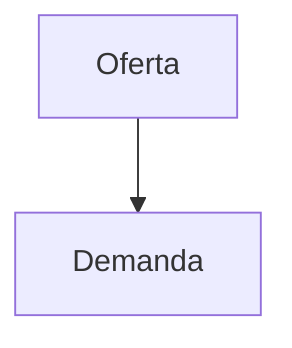

> **Este archivo es una plantilla de referencia, no un informe técnico.** Sirve para copiar
> el formato (notas al pie, enlaces, tablas, diagramas y fórmulas) al redactar informes nuevos.

## Notas al pie

El factor de planta[^1] incide en la energía firme[^2]. Y acá vuelvo a citar la primera[^1].

## Enlaces

- Enlace externo: [sitio del IPPSE](https://ippse.org.py)
- Enlace a otro informe: [ver el Informe 2/26](./informe-2-26.md)
- Enlace al PDF junto al .md: [descargar el informe](./informe-2-26.pdf)
- Enlace relativo a la carpeta documentos del repo: [PDF en documentos](../../documentos/informe-2-26.pdf)

## Imagen del repositorio

## Tablas

| Tecnología | Costo USD/MWh | Plazo |
|------------|--------------:|------:|
| Solar FV   | 45            | 3 años |
| Nuclear SMR| 120           | 15 años |

## Diagrama

## Fórmula

La energía es $E = mc^2$ y el rendimiento:

$$
\eta = \frac{P_{salida}}{P_{entrada}}
$$

[^1]: Relación entre la energía generada y la que se generaría a potencia nominal todo el tiempo.
[^2]: Potencia que puede entregarse de forma sostenida en las horas de mayor demanda.
