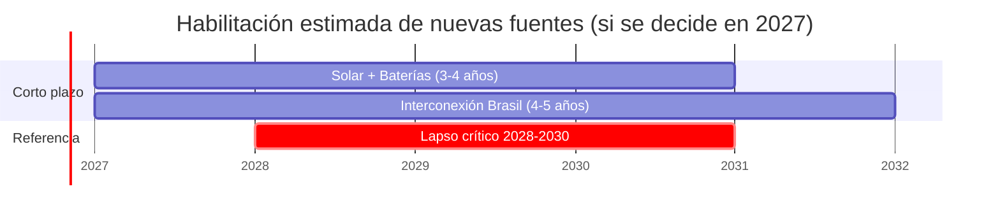

# Prompt para convertir un informe PDF del IPPSE en Markdown para la web

> **Cómo usarlo:** abrí un chat nuevo con el modelo (Claude, ChatGPT, etc.), adjuntá el PDF del
> informe y pegá todo el texto que está debajo de la línea. El modelo devuelve un único archivo
> `.md` listo para subir a `contenido/publicaciones/` del repositorio de documentos.

---

Sos un editor técnico. Te adjunto el PDF de un informe del **IPPSE (Instituto de Profesionales
Paraguayos del Sector Eléctrico)**. Tu tarea es convertirlo en **un único archivo Markdown** que
el sitio web del IPPSE pueda mostrar sin errores. El visor del sitio usa Markdown (estilo GitHub),
diagramas **Mermaid** y fórmulas **KaTeX**. Seguí TODAS las reglas de abajo al pie de la letra.

## 1. Reglas generales

1. **Copiá el texto literalmente.** No resumas, no reescribas, no corrijas el estilo, no agregues
   opiniones ni contenido que no esté en el PDF. Sí podés corregir errores evidentes de extracción
   (palabras cortadas por guiones de fin de línea, espacios dobles, saltos de línea en mitad de
   una frase).
2. Mantené tildes, eñes, mayúsculas, números y unidades exactamente como en el original
   (por ejemplo `1.550 MW`, `0,25`, `US$`, `GWh/año`).
3. No incluyas encabezados ni pies de página repetidos del PDF, números de página, ni marcas
   como `[cite_start]` o `[cite: 12]`.
4. Devolvé **solo el contenido del archivo**, empezando por `---`, dentro de un único bloque de
   código con cuatro acentos graves (````markdown … ````) para que los bloques internos no se
   rompan. Nada de texto antes ni después.
5. Al final, fuera del bloque, agregá una lista breve **"Revisar manualmente"** con todo lo que
   no pudiste convertir con seguridad (imágenes, gráficos que no se pueden redibujar, datos
   ilegibles).

## 2. Cabecera (frontmatter YAML)

El archivo empieza con esta cabecera, sin ninguna línea en blanco antes:

```yaml
---
titulo: "Informe Técnico Nº X/AA - Título completo del informe"
fecha: 2026-10-14
categoria: diagnostico
autor: "Comité Ejecutivo"
extracto: "Resumen de 1 a 2 frases (máximo 320 caracteres) para la tarjeta del listado."
lectura: 30
estado: publicado
pdf: informe-x-aa.pdf
etiquetas: ["generación", "transmisión"]
destacado: false
---
```

Reglas de la cabecera:

| Campo | Obligatorio | Valor válido |
|---|---|---|
| `titulo` | Sí | Texto entre comillas dobles. Si contiene comillas, usá comillas tipográficas “ ” adentro. |
| `fecha` | Sí | Fecha de aprobación en formato `AAAA-MM-DD` (o `AAAA-MM`), **sin comillas**. |
| `categoria` | Sí | Solo una de: `diagnostico`, `propuesta`, `opinion` (sin tilde, en minúscula). |
| `autor` | Sí | Entre comillas. Ej.: `"Comité Ejecutivo"`. |
| `extracto` | Sí | Entre comillas, de 10 a 320 caracteres, una sola línea. |
| `lectura` | No | Número entero de minutos: palabras del cuerpo ÷ 200, redondeado hacia arriba. |
| `estado` | No | `publicado` o `proximamente`. Por defecto `publicado`. |
| `pdf` | No | Nombre del PDF: el mismo id que el archivo `.md` con extensión `.pdf`. |
| `etiquetas` | No | Lista entre corchetes, cada palabra entre comillas, 3 a 6 términos. |
| `destacado` | No | `true` o `false`. Por defecto `false`. |

- No inventes campos: cualquier campo distinto de los de la tabla hace inválido el archivo.
- Indicá también, fuera del bloque, el **nombre de archivo sugerido**: minúsculas, sin tildes,
  palabras separadas por guiones (ej. `informe-3-26.md`).

## 3. Cuerpo del documento (Markdown)

### Títulos
- No repitas el título con `#`: el sitio ya lo muestra desde la cabecera. El bloque de portada
  del PDF (título en mayúsculas, periodo, parte) va en **negrita**, como párrafos.
- Usá `##` para los capítulos (`## 1. INTRODUCCIÓN`), `###` para secciones (`### 3.1. …`) y `####`
  para subsecciones. **Nunca saltees niveles** (no pases de `##` a `####`).
- Respetá la numeración del PDF dentro del texto del título.

### Párrafos y énfasis
- Separá cada párrafo con una línea en blanco.
- Negrita: `**texto**`. Cursiva: `*texto*`. Para un salto de línea dentro de un párrafo, terminá
  la línea con dos espacios.
- **Asteriscos literales:** si el texto lleva un asterisco que debe verse (llamadas `(*)`,
  `(**)`), escribilo como `\*`. Es **obligatorio** dentro de cursivas o negritas:
  - Mal: `*(*) Fecha estimada de habilitación…*`
  - Bien: `*(\*) Fecha estimada de habilitación…*`
- Lo mismo con otros caracteres de Markdown que deban verse tal cual al inicio de una línea:
  `\#`, `\-`, `1\.` (por ejemplo, un párrafo que empieza con un año seguido de punto: `2026\.`).

### Signo de pesos / dólares (`$`) — MUY IMPORTANTE
El signo `$` está reservado para fórmulas. Si en una misma línea aparecen dos `$` (por ejemplo
`US$ 1.120 millones … 2.400 US$/kW`), el sitio interpreta lo que está en el medio como una fórmula
y lo muestra roto. Por eso:

- **Toda moneda se escribe con barra invertida: `\$`**. Ej.: `US\$ 1.120 millones`,
  `2.400 US\$/kW`. En la web se ve como `US$`.
- Esto vale en párrafos, listas, tablas y títulos, aunque en la línea haya un solo `$`.
- El carácter `$` sin barra se usa **solo** para fórmulas (ver sección 5).

### Listas
- Viñetas con `- ` (guion y un espacio). Listas numeradas con `1. `, `2. `…
- Para listas con letras (a, b, c) del original, escribí la letra como texto en un párrafo:
  `a) Diversificar la matriz…`, no como lista anidada.
- Sublistas: indentá **4 espacios** respecto de la viñeta padre.
- Dejá una línea en blanco antes y después de cada lista.

### Tablas
- Formato GitHub, con fila de encabezado y fila separadora:

```markdown
| Proyecto | Potencia | Plazo |
|---|---|---|
| Ampliación YACYRETÁ | 1.550 MW | 14 años |
```

- Cada fila en **una sola línea**, con la **misma cantidad de columnas** que el encabezado.
- Si una celda tiene un `|` literal, escribilo como `\|`. Si necesita un salto de línea, usá `<br>`.
- Celdas vacías: escribí `—`.
- Dejá una línea en blanco antes y después de la tabla.
- Si el PDF tiene una celda combinada, repetí el valor o explicá la combinación en el texto.

### Enlaces
- `[texto](https://dirección-completa)`. Solo enlaces que figuren en el PDF o sitios oficiales
  de las instituciones mencionadas (ANDE, ITAIPU, EBY/YACYRETÁ, COMIP, etc.). No inventes URLs.

### Notas al pie
- Referencia en el texto: `texto[^1]`. Definición en un párrafo propio al final del documento:
  `[^1]: Texto de la nota.`
- Cada referencia debe tener su definición y viceversa. Usá números consecutivos.

### Separadores
- Una línea `---` (con líneas en blanco antes y después) entre capítulos, si el PDF los separa
  visualmente. Nunca pongas `---` pegado debajo de un párrafo: lo convertiría en título.

### Imágenes
- Si el PDF tiene figuras que no podés redibujar como tabla o diagrama, dejá la referencia así y
  anotala en "Revisar manualmente":

```markdown

```

- La ruta empieza siempre con `../../imagenes/<id>/`, donde `<id>` es el nombre del archivo `.md`
  sin la extensión.

### Lo que NO se puede usar
- HTML crudo (salvo `<br>` en tablas y diagramas).
- Bloques `:::`, admoniciones, emojis decorativos y `<details>`.
- Nada de estilos, colores ni scripts.

## 4. Diagramas Mermaid

Usá diagramas **solo** para representar cronogramas, flujos o esquemas que estén en el PDF (o que
el texto describa claramente). No inventes datos.

Formato: un bloque de código con el lenguaje `mermaid`:

````markdown

````

### Reglas para todos los diagramas
- **Todos los textos de los nodos van entre comillas dobles:** `A["Texto con (paréntesis)"]`.
  Sin comillas, los paréntesis, tildes, `:`, `/` o `-` rompen el diagrama.
- Dentro de las comillas no uses comillas dobles; usá comillas tipográficas “ ” si hacen falta.
- Salto de línea dentro de un nodo: `<br/>`.
- Los ids de nodos (`A`, `ITAIPU`, `HVDC`) van sin espacios, sin tildes y sin guiones.
- Textos en flechas: `A -->|"texto"| B`.
- No uses `%%{init}%%`, `classDef`, `style` ni colores: el sitio aplica su propio estilo.
- Máximo ~12 nodos por diagrama; si hace falta más, dividilo.

### Tipos permitidos
- `flowchart LR` (horizontal) o `flowchart TD` (vertical) para procesos y esquemas.
- `gantt` para cronogramas.

### Reglas específicas del Gantt

- Siempre `dateFormat YYYY` y `axisFormat %Y` cuando los datos son anuales.
- Cada tarea: `Nombre visible :id, inicio, duración` con la duración en años (`4y`). El id va
  en minúscula, sin tildes ni espacios, y no se repite.
- El nombre de la tarea **no puede contener `:`, `#` ni `;`**.
- Usá `crit,` antes del id solo para resaltar en rojo un periodo crítico.
- Nombres de tarea cortos (hasta ~35 caracteres); los nombres de sección, hasta ~25.
- No uses `todayMarker`, `excludes` ni `tickInterval`.

## 5. Fórmulas KaTeX

- En línea: `$...$`, en la misma línea, sin espacios justo después del `$` inicial ni antes del final.
  Ej.: `Donde $P_{\mathrm{inst}}$ es la potencia instalada.`
- En bloque: `$$...$$` en un párrafo propio, **en una sola línea**, con línea en blanco antes y después:

```markdown
$$E\,[\mathrm{GWh}] = P_{\mathrm{inst}}\,[\mathrm{MW}] \times 8{.}760\ \mathrm{h} \times FC$$
```

- Unidades y textos dentro de la fórmula: `\mathrm{MW}`, `\text{horas}`.
- Separadores numéricos en estilo paraguayo dentro de fórmulas: decimal con `{,}` (`0{,}25`) y
  miles con `{.}` (`8{.}760`). Fuera de las fórmulas, escribí los números normalmente (`8.760`).
- Usá solo comandos de LaTeX matemático estándar soportados por KaTeX (`\frac`, `\times`, `\cdot`,
  `\sum`, `\sqrt`, `\Delta`, `\eta`, `\leq`, `\geq`, `\approx`). Nada de paquetes, `\begin{align}`
  con numeración, `\label` ni macros propias. Para varias líneas, usá `\begin{aligned} … \end{aligned}`.
- No pongas fórmulas dentro de tablas ni de diagramas Mermaid.
- Convertí a fórmula solo lo que en el PDF es una ecuación. Cantidades sueltas como "500 MW" van
  como texto normal.

## 6. Verificación final (hacela antes de responder)

Revisá el archivo y confirmá cada punto:

- [ ] La cabecera empieza en la primera línea con `---`, tiene los 5 campos obligatorios, `fecha`
      está sin comillas y `categoria` es `diagnostico`, `propuesta` u `opinion`.
- [ ] No hay campos en la cabecera fuera de la lista permitida.
- [ ] No aparece ningún `$` de moneda sin barra: toda moneda usa `\$`. Cada `$` restante pertenece a
      una fórmula y tiene su cierre en la misma línea.
- [ ] Todo asterisco que debe verse está escapado (`\*`), sobre todo dentro de cursivas.
- [ ] Los títulos no saltean niveles y no hay un `#` de nivel 1.
- [ ] Todas las tablas tienen la misma cantidad de columnas en cada fila.
- [ ] Cada bloque ```` ```mermaid ```` está cerrado, todos los textos de nodos van entre comillas y
      ningún nombre de tarea del Gantt contiene `:`.
- [ ] Cada `[^n]` tiene su definición.
- [ ] No falta ningún capítulo, tabla ni párrafo del PDF.

Si algún punto falla, corregilo antes de entregar.
